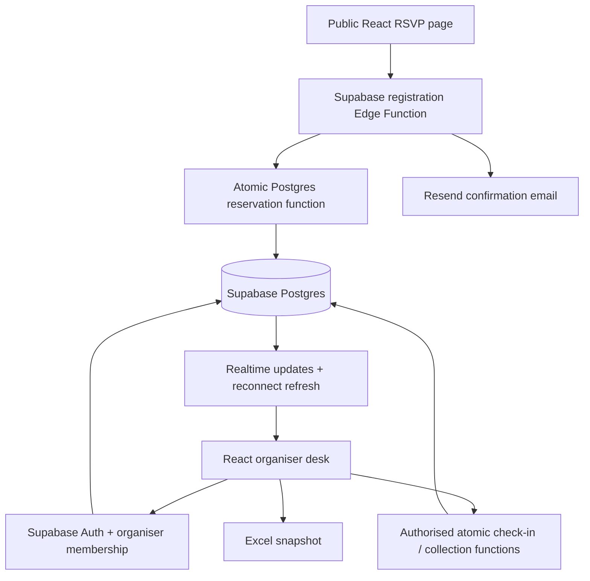

# Study Break Night 🧋

**[Open the repository](https://github.com/shounakm4/study-break-night)** · Local preview: `http://127.0.0.1:5174`

A phone-friendly RSVP and check-in app for a NUS Students’ Computing Club study break at COM1 foyer, 7–9 pm. Attendees do not create accounts. Organisers share a private, live dashboard.

Built for the Events Tech recruitment exercise. This is a student prototype, not an official club deployment. The event date must be confirmed before opening real registrations.

**Current status:** the app runs in browser-local preview mode. The shared Supabase backend and email integration are written but still need configuration and live verification. Preview RSVPs send no email, and different phones do not share preview data.

## Why I chose this approach

I chose the app to work like this cuz the organiser needs a simple registration and rsvp workflow, the telegram part would have been too complicated to do within a short time frame so i decided to stick with nus mail(it sents them a message there), the form still takes the users tele incase the organiser wants to confirm the attendee wants to come on the day itself but is late.

I made it simple and added a few fun elements to it(even tho it is AI generated but i believe a user is barely on the RSVP page for like a good 2 minutes just to register and get event info.).

I also added a organiser dashboard, for which they have to log in on the day itself and where they can see all the stats, like the RSVP numbers, so the comm can get their food quantity estimate and then can easily check in a registered person by typing their name and confirming(maybe if i had more time will add QR code confirmation from a QR code sent to attendees mail).

For the setup i went with react for the webpage and supabase for the shared data and organiser login. Attendees dont need to log in at all, only the organisers do. The dashboard also lets them export an excel copy for planning, but check in happens in the app so everyone is working with the same records.

For the bbt count, each nus email can only RSVP once per event and the backend decides who gets the last cup, so two ppl registering together cant both get cup number 150. Once all 150 are reserved ppl can still RSVP without bbt, and they still count towards the food estimate. At the door the organiser should confirm the ticket as well, typing a name is just to find the registration.

## Attendee flow

1. Open the event page and read the date, venue and reservation policy.
2. Enter a name, NUS student email ending in `@u.nus.edu`, and optional Telegram handle. The handle is for manual event-related contact by organisers; no Telegram bot is used.
3. Submit an RSVP without logging in.
4. The backend atomically reserves one cup if fewer than 150 active cup reservations exist. Total RSVPs help organisers decide how many snacks to order; snacks have no app-enforced quota.
5. See a ticket code and exact entitlements immediately. Once email delivery is configured, receive the same event details and ticket by email.
6. Show the ticket at the door. Organisers record arrival and food collection separately.
7. If cups are fully reserved, attendance is still allowed. The confirmation clearly says no bubble tea is reserved; it does not promise unavailable snacks.

A lost email does not cancel the RSVP. Retrying the same request must not create a second reservation. An unrelated request using an already registered email must not reveal the existing ticket.

## Organiser flow

1. Open **Organiser desk** and log in with an individually approved organiser account.
2. See total RSVPs, arrivals, cup reservations and collected bubble tea.
3. Search by name, email or ticket code. See the optional Telegram handle for manual contact.
4. Verify the attendee’s ticket and reservation status. Record arrival.
5. Mark a cup collected when handed over. The backend rejects repeat redemption, including simultaneous attempts from two phones.
6. Other organisers’ screens refresh from shared database changes. After reconnecting, reload authoritative data before continuing.
7. Download an Excel snapshot for planning or records. The spreadsheet is not used to redeem tickets or allocate stock.

Only approved organisers can read personal RSVP data. Logging in alone does not grant organiser access.

## How it works



- **Frontend:** React, TypeScript and Vite; deployable to Vercel.
- **Database:** Supabase Postgres. SQL functions enforce allocation and collection rules in transactions; React never decides whether the last cup is available.
- **Access:** Supabase Auth for organisers, membership checks and Row Level Security. Attendees submit through a narrow public endpoint and cannot list RSVP records.
- **Email:** a Supabase Edge Function calls Resend after reserving successfully. Provider secrets remain on the server. Email status distinguishes accepted, failed and not configured; accepted is not a guarantee of inbox delivery.
- **Live counts:** authenticated database subscriptions trigger fresh reads. Live UI updates do not replace transactional correctness.
- **Exports:** an on-demand .xlsx snapshot of the organiser’s current event data.

## Registration and check-in logic

1. **Validate the form.** A name, an email ending in exactly `@u.nus.edu`, and consent are required. The Telegram handle is optional. The email is trimmed and converted to lowercase, so capitalisation or surrounding spaces cannot create another RSVP.
2. **Prevent duplicates.** Each event allows one RSVP per normalised email. Retrying the same submission returns its existing receipt without using another cup. A new submission with an already registered email is rejected without revealing that attendee’s ticket.
3. **Allocate the cup in the database.** In live mode, the registration function locks the event row while checking capacity and saving the RSVP. Requests for the final cup are processed in order, so two successful registrations cannot both reserve it. The first 150 successful RSVPs receive one reserved cup each.
4. **Keep counting after cups run out.** Further RSVPs are accepted without a bubble-tea reservation. They still count toward attendance estimates. There is no snack quota or guaranteed snack reservation; the committee uses the total RSVP count to plan its order.
5. **Save first, then attempt email.** In configured live mode, the server saves the RSVP before asking Resend to email the event details, ticket code and cup reservation status. The page displays the ticket even if email fails or is not configured. An email failure does not erase the RSVP or allocate another cup on retry. The page distinguishes email accepted, failed and not configured.
6. **Record arrival separately from collection.** An approved organiser checks the ticket and marks the attendee as arrived. When a reserved cup is handed over, they mark it collected. The live database checks permissions and prevents that ticket from collecting a second cup, including when two organisers try at once.
7. **Refresh the organiser dashboard.** In live mode, Supabase Realtime notifications trigger fresh reads of the shared data. Excel downloads are snapshots for planning or records; editing an exported file does not change registrations or stock.

Preview mode uses browser storage to demonstrate these flows. Its duplicate and capacity checks apply only within that browser; the shared database rules apply once Supabase is connected. The live locking behaviour still needs testing with competing requests and multiple phones.

## Counts and reservation rules

| Count                       | Meaning                                                       |
| --------------------------- | ------------------------------------------------------------- |
| RSVPs                       | People registered, including people without a cup reservation |
| Arrivals                    | People recorded at the door                                   |
| Cups available to reserve   | 150 minus active cup reservations                             |
| Reserved cups not collected | Reserved cups minus cups collected                            |
| Physical cups remaining     | Initial stock minus actual cups distributed                   |

Cup reservations are first-successful-RSVP-first-reserved. Registration order is determined in the database, not by who loaded the page first. Email and Telegram handle are not proof of student identity. Only the exact `@u.nus.edu` domain is accepted, with whitespace trimmed and case normalised. One RSVP per event/email is enforced in Postgres. The form and Edge Function also validate the domain, and the database has its own constraint. Domain validation does not prove mailbox ownership; email verification is not implemented, so someone could still enter another student’s address or use aliases.

A reservation belongs to its ticket. Uncollected cups are not automatically free stock for walk-ins. Cancellation and no-show release policy need organiser agreement; automatic releases are outside the initial version.

Snacks have no quantity limit in this app. Organisers use the RSVP total to plan the snack order. Snack availability is not a database-backed reservation or guarantee.

## First iteration and preview mode

The first iteration includes an attendee page, reservation result, organiser desk, browser-local preview data, Supabase SQL/functions, and Excel export. Preview mode is explicitly labelled and uses synthetic example.com attendees. It sends no email and is not a real authenticated organiser system.

Supabase live mode requires project configuration, migrations, an approved organiser account, and function deployment. Real email additionally requires a Resend account and verified sender domain. These external services are not provisioned by running the frontend.

The UI follows the supplied club website reference: white background, navy `#365486`, light blue `#61afef`, and the user-provided Computing Club logo. The Study Break title uses Georgia italic to match the supplied reference, with the organiser subtitle directly below it. A lightweight SVG shows students sharing a study break and bubble tea, and the footer pairs the supplied club logo with the organiser credit. No official endorsement is implied.

## Local development

```bash
npm install
npm run dev
```

Without Supabase environment variables, the app runs in clearly labelled local preview mode. Use fictional information only. Browser storage is device-local and can be cleared; it is not suitable for a real event across multiple phones.

```bash
npm run check
npm run format:check
npm test
npm run build
```

## Live setup

See [docs/setup.md](docs/setup.md) for the database, organiser provisioning, Edge Function, email and Vercel steps. Never commit .env files or a service-role key.

Frontend variables contain only the Supabase URL, publishable/anon key and event ID. Service-role and email-provider keys belong only in Supabase Edge Function secrets.

## Scope and limitations

- The event date is initially unconfirmed. Snack quantities are planned by organisers from RSVP totals.
- No Telegram automation, stamp rally, QR scanning, payments, cancellation workflow or offline redemption. Ticket codes are searchable; QR scanning can follow later.
- A ticket is a bearer credential; one-time redemption prevents reuse, not sharing before first collection. Organisers can compare the displayed name with the attendee.
- Email may be delayed or filtered. The on-screen ticket remains valid.
- Public RSVP endpoints need abuse controls; capacity transactions do not prove identity.
- The live deployment must be tested with two organiser phones and competing requests before real use. Local tests do not establish hosted service performance or email deliverability.

## AI note

To be very honest, i completely vibe coded this app while using iterative UI and logic development and cotinuous testing of the live page.

As a events tech, with not much time(esp w a pile of my own tutorials waiting for me😭) i believe this is the workflow i would go for as long as i am able to test it and check it works with multiple users and it achieves the objective, so yes this would not have been possible in the span of 2-3 hours without the help of my best friend(codex) but i believe as long as i am aware of the backend logic and personally enhance UI then it should be ok.

To be specific, codex helped write the react components, database setup, backend functions, tests and readme(including helping with this note). One assumption i had to correct was the snack quota, cuz we only need the RSVP count to estimate food, not reserve a fixed number of snacks.

Also when i say testing the live page above, so far thats the local browser preview. Supabase and email still need to be connected, so no emails are being sent yet and the preview data isnt shared across phones. Codex ran the automated checks, but i still need to test with multiple phones and ppl registering at the same time once the backend is connected.

## References

- [Supabase database functions](https://supabase.com/docs/guides/database/functions)
- [Supabase Row Level Security](https://supabase.com/docs/guides/database/postgres/row-level-security)
- [Supabase Realtime](https://supabase.com/docs/guides/realtime/postgres-changes)
- [Sending email from Supabase](https://supabase.com/docs/guides/functions/examples/send-emails)
- [Vite on Vercel](https://vercel.com/docs/frameworks/frontend/vite)

## Verified in the first iteration

- 16 local tests pass, including the SQL migration in embedded Postgres, access restrictions, retry safety, NUS-only email validation, capacity allocation and duplicate redemption.
- TypeScript checking and the production build pass.
- Browser preview exercised RSVP → ticket → organiser search → arrival → cup collection.
- A downloaded Excel file was reopened and checked for the expected attendee and reservation data.
- Attendee and organiser pages were visually checked at 390px phone width with no horizontal overflow.
- Live Supabase, actual email delivery, cross-device hosted updates and Vercel deployment remain unverified until those accounts are configured.
