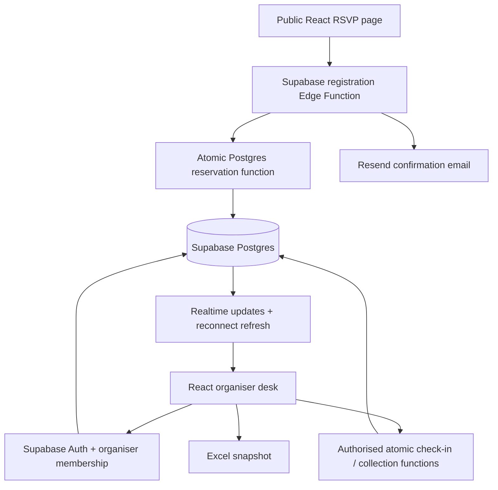

# Study Break Night 🧋

A phone-friendly RSVP and check-in app for a NUS Students’ Computing Club study break at COM1 foyer, 7–9 pm. Attendees do not create accounts. Organisers share a private, live dashboard.

Built for the Events Tech recruitment exercise. This is a student prototype, not an official club deployment. The event date and snack quantity must be confirmed before opening real registrations.

## Attendee flow

1. Open the event page and read the date, venue and reservation policy.
2. Enter a name, email and optional Telegram handle. The handle is for manual event-related contact by organisers; no Telegram bot is used.
3. Submit an RSVP without logging in.
4. The backend atomically reserves one cup if fewer than 150 active cup reservations exist. A snack is guaranteed only when a configured snack allocation is available.
5. See a ticket code and exact entitlements immediately. Once email delivery is configured, receive the same event details and ticket by email.
6. Show the ticket at the door. Organisers record arrival and food collection separately.
7. If cups are fully reserved, attendance is still allowed. The confirmation clearly says no bubble tea is reserved; it does not promise unavailable snacks.

A lost email does not cancel the RSVP. Retrying the same request must not create a second reservation. An unrelated request using an already registered email must not reveal the existing ticket.

## Organiser flow

1. Open **Organiser desk** and log in with an individually approved organiser account.
2. See total RSVPs, arrivals, reserved food and collected food.
3. Search by name, email or ticket code. See the optional Telegram handle for manual contact.
4. Verify the attendee’s ticket and reservation status. Record arrival.
5. Mark a cup and/or snack collected when handed over. The backend rejects repeat redemption, including simultaneous attempts from two phones.
6. Other organisers’ screens refresh from shared database changes. After reconnecting, reload authoritative data before continuing.
7. Download an Excel snapshot for planning or records. The spreadsheet is not used to redeem tickets or allocate stock.

Only approved organisers can read personal RSVP data. Logging in alone does not grant organiser access.

## How it works



- **Frontend:** React, TypeScript and Vite; deployable to Vercel.
- **Database:** Supabase Postgres. SQL functions enforce allocation and collection rules in transactions; React never decides whether the last cup is available.
- **Access:** Supabase Auth for organisers, membership checks and Row Level Security. Attendees submit through a narrow public endpoint and cannot list RSVP records.
- **Email:** a Supabase Edge Function calls Resend after reserving successfully. Provider secrets remain on the server. Email status distinguishes accepted, failed and not configured; accepted is not a guarantee of inbox delivery.
- **Live counts:** authenticated database subscriptions trigger fresh reads. Live UI updates do not replace transactional correctness.
- **Exports:** an on-demand .xlsx snapshot of the organiser’s current event data.

## Counts and reservation rules

| Count | Meaning |
| --- | --- |
| RSVPs | People registered, including people without a cup reservation |
| Arrivals | People recorded at the door |
| Cups available to reserve | 150 minus active cup reservations |
| Reserved cups not collected | Reserved cups minus cups collected |
| Physical cups remaining | Initial stock minus actual cups distributed |

Cup reservations are first-successful-RSVP-first-reserved. Registration order is determined in the database, not by who loaded the page first. Email and Telegram handle are not proof of student identity. One RSVP per normalised email prevents accidental duplicates but cannot stop one person using different addresses.

A reservation belongs to its ticket. Uncollected cups are not automatically free stock for walk-ins. Cancellation and no-show release policy need organiser agreement; automatic releases are outside the initial version.

Snack capacity is independent of the 150-cup limit. With an unknown snack quantity, the app says **snacks while stocks last**, rather than reserving unlimited snacks.

## First iteration and preview mode

The first iteration includes an attendee page, reservation result, organiser desk, browser-local preview data, Supabase SQL/functions, and Excel export. Preview mode is explicitly labelled and uses synthetic example.com attendees. It sends no email and is not a real authenticated organiser system.

Supabase live mode requires project configuration, migrations, an approved organiser account, and function deployment. Real email additionally requires a Resend account and verified sender domain. These external services are not provisioned by running the frontend.

The UI uses the club website’s navy `#365486` and blue `#61afef`, with warm cream, tea-coloured accents and a study-break theme. No official endorsement is implied.

## Local development

```bash
npm install
npm run dev
```

Without Supabase environment variables, the app runs in clearly labelled local preview mode. Use fictional information only. Browser storage is device-local and can be cleared; it is not suitable for a real event across multiple phones.

```bash
npm run check
npm test
npm run build
```

## Live setup

See [docs/setup.md](docs/setup.md) for the database, organiser provisioning, Edge Function, email and Vercel steps. Never commit .env files or a service-role key.

Frontend variables contain only the Supabase URL, publishable/anon key and event ID. Service-role and email-provider keys belong only in Supabase Edge Function secrets.

## Scope and limitations

- Event date and snack quantity are initially unconfirmed.
- No Telegram automation, stamp rally, payments, cancellation workflow or offline redemption.
- A ticket is a bearer credential; one-time redemption prevents reuse, not sharing before first collection. Organisers can compare the displayed name with the attendee.
- Email may be delayed or filtered. The on-screen ticket remains valid.
- Public RSVP endpoints need abuse controls; capacity transactions do not prove identity.
- The live deployment must be tested with two organiser phones and competing requests before real use. Local tests do not establish hosted service performance or email deliverability.

## How AI was used

Codex helped plan the flows and write the initial README, UI, database migration, functions and checks. Shounak is iterating on the design and behaviour. This is substantial AI assistance; the code should be reviewed and understood before submission. Keep this note updated with actual changes and corrections rather than inventing an AI mistake.

## References

- [Supabase database functions](https://supabase.com/docs/guides/database/functions)
- [Supabase Row Level Security](https://supabase.com/docs/guides/database/postgres/row-level-security)
- [Supabase Realtime](https://supabase.com/docs/guides/realtime/postgres-changes)
- [Sending email from Supabase](https://supabase.com/docs/guides/functions/examples/send-emails)
- [Vite on Vercel](https://vercel.com/docs/frameworks/frontend/vite)
